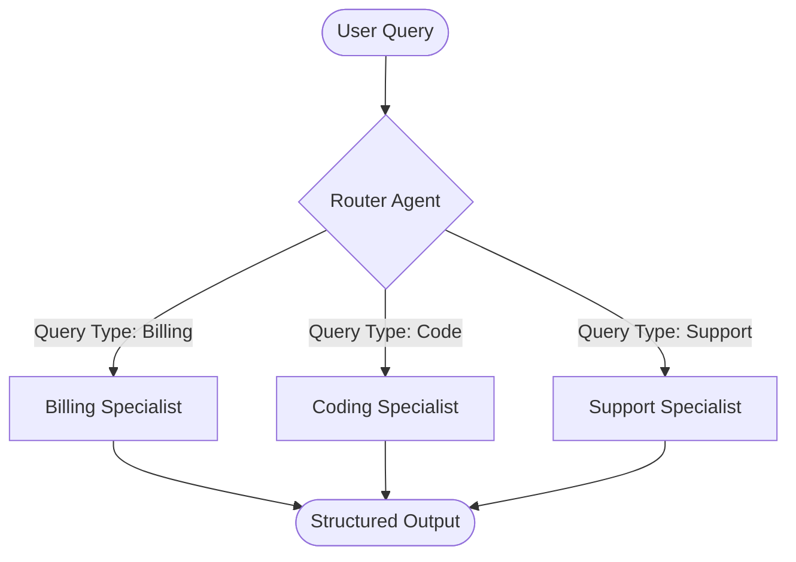
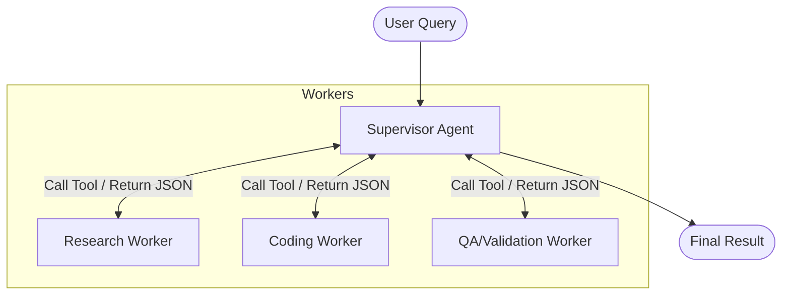
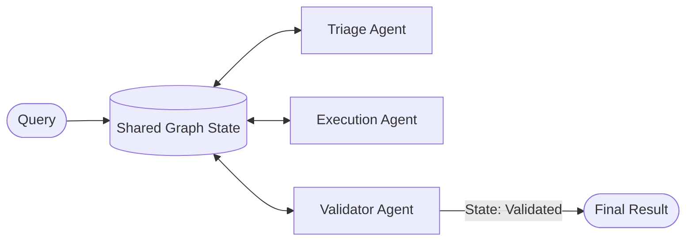

The landscape of Artificial Intelligence has fundamentally shifted. In 2026, we are moving away from basic Retrieval-Augmented Generation (RAG) chatbots toward **autonomous agentic assistants**. These systems do not just answer questions—they reason, execute tools, manage complex states, and collaborate to solve multi-step problems.

However, moving from a single agent prototype to a production-grade multi-agent system introduces significant architectural challenges. How do you delegate work? How do you prevent infinite loops? How do you guarantee that agents communicate in structured formats?

This guide details the core design patterns of modern Agentic AI Assistants and provides a production-ready python implementation using **PydanticAI**.

---

## The Three Core Multi-Agent Patterns

When scaling an agentic system, you must choose how your agents coordinate. The three standard industry patterns are **Router**, **Supervisor**, and **Choreography**.

### 1. The Router Pattern (Classification & Delegation)

The Router is the simplest multi-agent pattern. A single, lightweight orchestrator analyzes the user's intent and routes the query to exactly **one** specialized agent. Once delegated, the specialized agent handles the remaining interaction directly with the user.



*   **Best for**: Systems with distinct, isolated domains (e.g., triage bots).
*   **Advantage**: Low latency and token efficiency, as only one specialized agent runs.

---

### 2. The Supervisor Pattern (Centralized Orchestration)

In the Supervisor pattern, a central coordinator agent acts as the manager. It maintains the user's ultimate goal, executes a reasoning loop, calls specialized worker agents as "tools," aggregates their outputs, and determines when the final goal has been achieved.



*   **Best for**: Complex workflows requiring multiple steps, feedback loops, and sequential validation (e.g., code generation and test execution).
*   **Advantage**: The supervisor acts as a centralized brain, keeping context clean for the specialized workers.

---

### 3. The Choreography Pattern (Decentralized State Machines)

In Choreography, there is no supervisor. Agents coordinate by reacting to events or changes in a shared state machine (often built using LangGraph). Each agent performs its task and writes its result to the state. The updated state then triggers the next agent based on transition rules.



*   **Best for**: Highly stateful, looping, or non-linear business processes (e.g., automated document auditing pipelines).
*   **Advantage**: Modular and highly flexible, but can be difficult to debug if infinite state loops occur.

---

## State and Memory Architecture

A major challenge in agentic design is managing state. An assistant needs two types of memory:

1.  **Short-Term (Conversational) Memory**: The sliding context window containing the current conversation history. In production, this is stored in a fast caching layer like **Redis** or a lightweight SQLite database and Hydrated/Dehydrated per request.
2.  **Long-Term Memory**: Persistent store containing user preferences, historical interactions, and domain knowledge. This is typically split between:
    *   **Vector Databases** (e.g., pgvector) for semantic retrieval.
    *   **Graph Databases** for relational entities (e.g., mapping a customer's organization structure).

---

## Implementation: Type-Safe Multi-Agent Supervisor in PydanticAI

Let's implement the **Supervisor Pattern** programmatically. PydanticAI is designed from the ground up for type-safe agent interactions, making it perfect for orchestrating multi-agent systems.

Here, a **Supervisor Agent** coordinates a **Researcher Agent** and a **Writer Agent** to produce a verified report.

```python
import os
from pydantic import BaseModel, Field
from pydantic_ai import Agent, RunContext

# =====================================================================
# 1. Define Structured Output Schemas (Guarantees Type Safety)
# =====================================================================

class ResearchData(BaseModel):
    summary: str = Field(description="Synthesized summary of the facts.")
    sources: list[str] = Field(description="Key reference articles or URLs.")

class FinalReport(BaseModel):
    title: str = Field(description="Catchy title for the technical report.")
    content: str = Field(description="Markdown formatted body content.")
    target_keywords: list[str] = Field(description="SEO keywords targeted in content.")

# =====================================================================
# 2. Initialize Worker Agents (Specialized LLM Tasks)
# =====================================================================

researcher = Agent(
    model="gemini/gemini-1.5-flash",
    result_type=ResearchData,
    system_prompt=(
        "You are an expert technical researcher. Search for facts, structure your "
        "findings cleanly, and list your sources."
    )
)

writer = Agent(
    model="gemini/gemini-1.5-flash",
    result_type=FinalReport,
    system_prompt=(
        "You are an elite developer marketing copywriter. Take research inputs and "
        "draft high-quality, engaging markdown articles targeting developers."
    )
)

# =====================================================================
# 3. Define Supervisor Dependencies & Orchestration Agent
# =====================================================================

class SupervisorDeps:
    def __init__(self):
        self.researcher = researcher
        self.writer = writer

supervisor = Agent(
    model="gemini/gemini-1.5-flash",
    deps_type=SupervisorDeps,
    result_type=FinalReport,
    system_prompt=(
        "You are the central Supervisor Agent. Your goal is to produce a verified "
        "markdown report on the user's query.\n\n"
        "STEPS TO RUN:\n"
        "1. Delegate research to the researcher agent via the 'perform_research' tool.\n"
        "2. Send that research summary to the writer agent via the 'draft_report' tool.\n"
        "3. Review the draft report and return the structured FinalReport."
    )
)

# =====================================================================
# 4. Bind Workers as Supervisor Tools
# =====================================================================

@supervisor.tool
async def perform_research(ctx: RunContext[SupervisorDeps], topic: str) -> ResearchData:
    """Delegate research gathering to the researcher worker agent."""
    print(f"🕵️ Supervisor delegating research for: {topic}")
    result = await ctx.deps.researcher.run(topic)
    return result.data

@supervisor.tool
async def draft_report(
    ctx: RunContext[SupervisorDeps], 
    research_summary: str, 
    sources: list[str]
) -> FinalReport:
    """Delegate report formatting and copywriting to the writer worker agent."""
    print("✍️ Supervisor delegating report drafting to writer...")
    prompt = f"Research Summary: {research_summary}\nSources: {sources}"
    result = await ctx.deps.writer.run(prompt)
    return result.data

# =====================================================================
# 5. Execute the Multi-Agent System
# =====================================================================

async def main():
    deps = SupervisorDeps()
    topic = "The performance benefits of Prompt Caching in Gemini 3.5 Flash"
    
    result = await supervisor.run(
        f"Create a technical report about: {topic}",
        deps=deps
    )
    
    print("\n🚀 FINAL REPORT COMPLETED:")
    print(f"Title: {result.data.title}")
    print(f"Keywords: {result.data.target_keywords}")
    print(f"\n{result.data.content}")

if __name__ == "__main__":
    import asyncio
    asyncio.run(main())
```

---

## Crucial Guardrails for Production Assistants

When deploying this architecture, developers must set up guardrails to handle failure cases:

1.  **Token Limit Fail-safes**: Deep multi-agent recursion can quickly exhaust the LLM's context window. Implement a counter to terminate execution if the number of supervisor iteration loops exceeds a threshold (e.g. 5 loops).
2.  **Schema Repair Hooks**: When worker agents output malformed JSON, configure your validation middleware to automatically feed the validation error *back* into the worker agent's next prompt to auto-correct the layout.
3.  **Human-in-the-Loop (HITL) Interrupts**: For critical tool executions, don't execute the tool immediately inside the agent loop. Instead, suspend the supervisor state, store it in your DB, expose a "Review" button to the user via Webhook, and resume execution after approval.

## Conclusion

Building modern Agentic AI Assistants requires moving past the simple single-agent paradigm. By selecting the right coordination pattern—whether it's the simplicity of a **Router**, the control of a **Supervisor**, or the flexibility of **Choreography**—and using type-safe validation tools like **PydanticAI**, you can build reliable, production-ready AI assistants that scale.

*Want to build more high-accuracy automations? Explore our guide to [building PDF and image parsing APIs](/build-high-accuracy-automations-gemini-api/) and [implementing local document fraud detection pipeline](/best-document-fraud-detection-software-2026/).*
