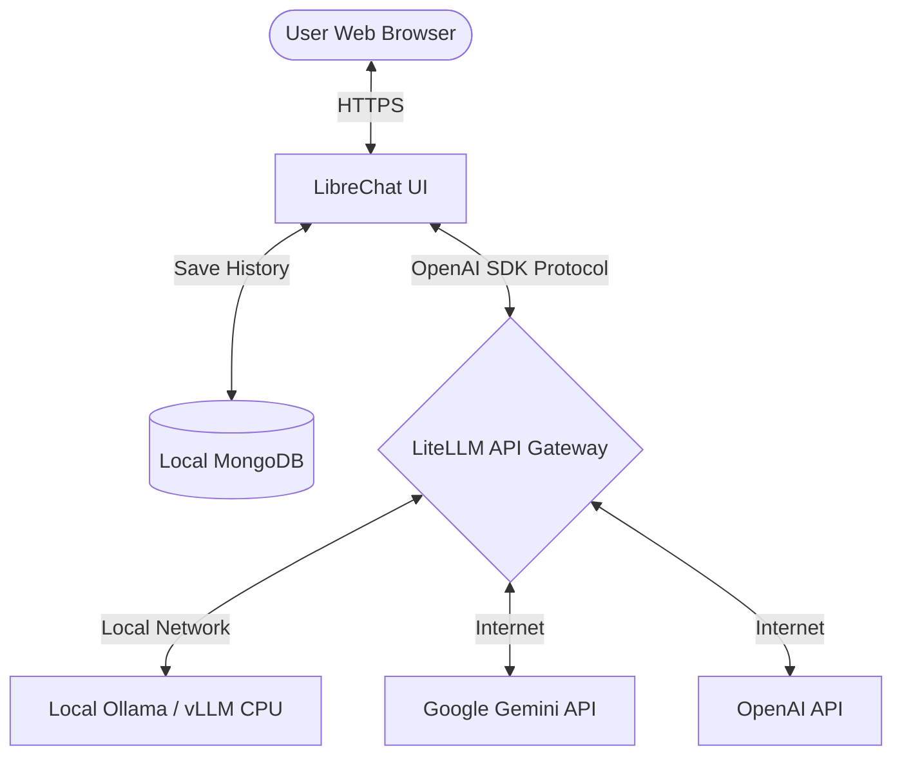

Data privacy is the single biggest hurdle for companies looking to adopt generative AI assistants. Sending proprietary code, financial records, or customer data to commercial APIs exposes organizations to severe data leakage risks and compliance violations.

The solution is **self-hosting**. By deploying an open-source chatbot interface and routing traffic through a local API gateway, you can create a private, secure, enterprise-grade ChatGPT alternative. 

This tutorial walks through deploying the industry-standard open-source stack: **LibreChat** (the frontend UI), **LiteLLM** (the routing and proxy gateway), and **MongoDB** (conversational history storage) using **Docker Compose**.

---

## The Self-Hosted AI Stack Architecture

Before looking at code, let's analyze how data flows in this architecture:



*   **LibreChat**: Provides a modern, ChatGPT-like interface supporting multi-user authentication, file attachments, search, and custom agent presets.
*   **MongoDB**: Statically stores conversation histories, settings, and user profiles locally.
*   **LiteLLM**: Standardizes API calls. Whether routing to a local model running on Ollama or a remote model on Vertex AI, LiteLLM presents a unified, OpenAI-compatible API to LibreChat.

---

## Step 1: Create the Directory Structure

Create a new directory for your project and initialize the configuration files:

```bash
mkdir self-hosted-chatbot && cd self-hosted-chatbot
touch docker-compose.yml config.yaml librechat.yaml .env
```

---

## Step 2: Configure LiteLLM (`config.yaml`)

`config.yaml` tells LiteLLM which models are available and how to route traffic. In this configuration, we expose a local Llama 3 model running on Ollama and route commercial APIs (Gemini & OpenAI) securely:

```yaml
model_list:
  # 1. Local Model via Ollama
  - model_name: local-llama3
    litellm_params:
      model: ollama/llama3
      api_base: http://host.docker.internal:11434
      tpm: 100000
      rpm: 1000

  # 2. Google Gemini Flash
  - model_name: gemini-3.5-flash
    litellm_params:
      model: gemini/gemini-1.5-flash
      api_key: os.environ/GEMINI_API_KEY

  # 3. OpenAI GPT-4.1
  - model_name: gpt-4.1-nano
    litellm_params:
      model: gpt-4.1-nano
      api_key: os.environ/OPENAI_API_KEY

router_settings:
  routing_strategy: usage-based-routing-v2
  enable_fallbacks: true
```

*   **`host.docker.internal`**: Allows the containerized LiteLLM instance to access an Ollama server running locally on the host machine.
*   **`os.environ/...`**: LiteLLM pulls sensitive API keys directly from Docker environment variables, keeping configurations secure.

---

## Step 3: Configure LibreChat (`librechat.yaml`)

We configure LibreChat to communicate with LiteLLM as a custom endpoint. This maps all models declared in LiteLLM directly to LibreChat's interface:

```yaml
# librechat.yaml
version: 1.1.0

# Configure Custom Endpoints
endpoints:
  custom:
    - name: "LiteLLM Gateway"
      apiKey: "sk-litellm-dummy-key"
      baseURL: "http://litellm:4000/v1"
      models:
        default: ["local-llama3", "gemini-3.5-flash", "gpt-4.1-nano"]
        fetch: false
      titleConvo: true
      titleModel: "gemini-3.5-flash"
      summarize: true
      convoTokenLimit: 4096

# Disable other built-in direct endpoints to force LiteLLM routing
interface:
  endpointsMenu: true
```

---

## Step 4: The Docker Compose Stack (`docker-compose.yml`)

Now, we define the unified services to run MongoDB, LiteLLM, and LibreChat together.

```yaml
version: '3.8'

services:
  # 1. Database for LibreChat
  mongodb:
    image: mongo:6.0
    container_name: chatbot-db
    restart: unless-stopped
    volumes:
      - mongo-data:/data/db
    networks:
      - chatbot-network

  # 2. LiteLLM Proxy Gateway
  litellm:
    image: ghcr.io/berriai/litellm:main-latest
    container_name: chatbot-gateway
    restart: unless-stopped
    volumes:
      - ./config.yaml:/app/config.yaml
    ports:
      - "4000:4000"
    command: ["--config", "/app/config.yaml", "--port", "4000", "--detailed_debug"]
    environment:
      - OPENAI_API_KEY=${OPENAI_API_KEY}
      - GEMINI_API_KEY=${GEMINI_API_KEY}
      - LITELLM_MASTER_KEY=sk-litellm-dummy-key
    extra_hosts:
      - "host.docker.internal:host-gateway"
    networks:
      - chatbot-network

  # 3. LibreChat Frontend
  librechat:
    image: ghcr.io/danny-avila/librechat-dev:latest
    container_name: chatbot-ui
    restart: unless-stopped
    ports:
      - "3080:3080"
    depends_on:
      - mongodb
      - litellm
    volumes:
      - ./librechat.yaml:/app/librechat.yaml
      - uploads:/app/client/public/images
    environment:
      - HOST=0.0.0.0
      - PORT=3080
      - MONGO_URI=mongodb://mongodb:27017/LibreChat
      - JWT_SECRET=${JWT_SECRET}
      - CREDS_KEY=${CREDS_KEY}
      - CREDS_IV=${CREDS_IV}
      - APP_TITLE="Enterprise Private Chat"
      - CUSTOM_CONFIG_PATH=/app/librechat.yaml
    networks:
      - chatbot-network

volumes:
  mongo-data:
  uploads:

networks:
  chatbot-network:
    name: chatbot-network
```

---

## Step 5: Setup Environment Secrets (`.env`)

Generate the cryptographic secrets required by LibreChat to secure user sessions and encrypt database credentials. Create a `.env` file in the same directory:

```env
# API Keys (leave blank if running purely local models)
OPENAI_API_KEY=your-openai-api-key-here
GEMINI_API_KEY=your-gemini-api-key-here

# Cryptographic secrets for LibreChat (Replace with random 32-character hex strings)
JWT_SECRET=428bb8fa4d9d19a2e6e3c834a34b22c1
CREDS_KEY=f60db9378c2bd92e85a08332decf8c4d
CREDS_IV=e921d234a90bd71a
```

---

## Step 6: Booting the Stack

Spin up the entire stack with a single command:

```bash
docker compose up -d
```

Check the running containers to verify everything initialized successfully:

```bash
docker compose ps
```

You should see all three services (`chatbot-db`, `chatbot-gateway`, and `chatbot-ui`) in the `Up` state.

---

## Accessing Your Chatbot

1.  Open your browser and navigate to `http://localhost:3080`.
2.  Click **Sign Up** to register the administrator account (the first registered account automatically gains admin privileges).
3.  Select **LiteLLM Gateway** from the model selection dropdown.
4.  Choose your model (e.g. `local-llama3`) and start chatting privately!

## Conclusion

By deploying **LibreChat** and **LiteLLM** on Docker, you give your team access to a state-of-the-art conversational interface while retaining full control over your data. Adding new models is as simple as updating LiteLLM's `config.yaml` and restarting the container.

*Ready to build more local automations? Explore our guide to [serving open-source LLMs locally on CPU](/serving-lightweight-open-source-llms-locally-on-cpu-best-practices/) and [building localized document extraction pipelines](/kyc-document-extraction-pipeline-gemini-ocr-langgraph/).*
