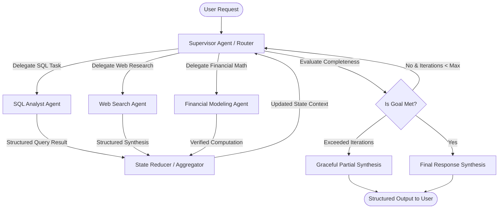

Monolithic "mega-agents"—single LLM agents equipped with 30 different tools, a 5,000-word prompt, and instructions to do everything from searching the web to executing SQL queries and drafting marketing copy—routinely fail in production.

As the number of tools grows, model accuracy degrades exponentially due to **tool selection confusion**, **context window bloat**, and **conflicting prompt directives**. An agent trying to be an expert data engineer, legal compliance auditor, and creative copywriter will inevitably hallucinate table schemas or violate brand rules.

The industry solution is the **Supervisor Pattern**: a hierarchical orchestration architecture where a central reasoning supervisor delegates tasks to dedicated, domain-specific worker agents with isolated tools, reviewing their outputs before finalizing the user response.

In this guide, we engineer an enterprise multi-agent pipeline combining **LangGraph** (for cyclic state orchestration and checkpointing) with **PydanticAI** (for type-safe worker execution and strict schema validation).

---

## 1. Architectural Blueprint: The Hierarchical State Graph

In this architecture, worker agents do not talk directly to each other (which causes chaotic peer-to-peer ping-pong loops). Instead, all coordination flows through the **Supervisor Agent**, which maintains the central source of truth:



### Core Design Principles:
1. **Tool Isolation**: The SQL agent only has access to database connectors; the search agent only has access to search APIs. Neither sees the other's tool schemas, saving thousands of tokens per inference step.
2. **Type-Safe Handoffs**: Rather than passing unformatted conversational text, agents pass structured Pydantic models containing explicitly typed data payloads and confidence scores.
3. **Deterministic Circuit Breakers**: A hard limit prevents runaway API billing from infinite re-planning loops.

---

## 2. Defining the Shared Graph State & Schemas

We start by defining the typed state schema that flows across nodes in the LangGraph state machine, alongside the structured routing models:

```python
from typing import TypedDict, Annotated, List, Literal, Optional
from pydantic import BaseModel, Field
import operator

# Structured decision schema for the Supervisor
class WorkerDelegation(BaseModel):
    next_worker: Literal["sql_analyst", "web_researcher", "financial_analyst", "FINISH"] = Field(
        ...,
        description="The specialized agent to invoke next, or FINISH if all information has been gathered."
    )
    instruction: str = Field(
        ...,
        description="Precise, targeted instructions for the chosen worker based on current state gaps."
    )
    reasoning: str = Field(
        ...,
        description="Internal rationale explaining why this delegation step is required."
    )

# Structured outputs returned by specialized workers
class WorkerResult(BaseModel):
    worker_name: str
    output: str
    success: bool
    data_points: List[str] = Field(default_factory=list)

# LangGraph Shared State
class AgentTeamState(TypedDict):
    user_query: str
    messages: Annotated[List[str], operator.add]
    iteration_count: int
    worker_results: Annotated[List[WorkerResult], operator.add]
    final_response: Optional[str]
```

---

## 3. Implementing the Specialized PydanticAI Workers

Each worker is an isolated `pydantic_ai.Agent` instance configured with dedicated tools and narrow system instructions:

```python
import os
from pydantic_ai import Agent, RunContext
from pydantic import BaseModel

# Worker 1: SQL Analyst with Database Tools
class SQLQueryInput(BaseModel):
    query: str

sql_agent = Agent(
    "google-gla:gemini-2.5-flash",
    system_prompt=(
        "You are an expert PostgreSQL data engineer. Translate instructions into safe SELECT queries, "
        "execute them via the database tool, and return structured analysis of rows. Never execute UPDATE or DELETE."
    )
)

@sql_agent.tool_plain
def execute_readonly_sql(query: str) -> str:
    """Executes a validated read-only SQL query against the enterprise replica."""
    # Production connector stub
    if "drop" in query.lower() or "delete" in query.lower() or "insert" in query.lower():
        return "ERROR: Destructive write operations forbidden."
    return f"Simulated Query Result for: '{query}' -> [Revenue: $4,290,000, Customers: 1,840, CAC: $142]"

# Worker 2: Web Research Agent with Retrieval Tools
web_agent = Agent(
    "google-gla:gemini-2.5-flash",
    system_prompt=(
        "You are a technical research specialist. Gather current industry benchmarks, public competitor "
        "intelligence, and API documentation. Be concise and cite factual metrics."
    )
)

@web_agent.tool_plain
def search_market_intelligence(topic: str) -> str:
    """Searches real-time web sources for market trends and competitor benchmarks."""
    # Production search connector stub (e.g. Tavily / Exa)
    return (
        f"Search Results for '{topic}': "
        "Industry average SaaS CAC in 2026 is $185-$220. Enterprise net retention average is 112%."
    )
```

---

## 4. The Supervisor Node & Routing Logic

The supervisor agent evaluates the state of the conversation, reviews prior worker contributions, and selects the next action:

```python
supervisor_agent = Agent(
    "google-gla:gemini-2.5-flash",
    result_type=WorkerDelegation,
    system_prompt="""
You are the Executive Supervisor orchestrating a multi-agent analytics team.
Your objective is to answer the user's high-level business question by delegating sub-tasks to specialists:
- sql_analyst: Queries internal databases for revenue, customer metrics, and product usage.
- web_researcher: Searches external market benchmarks, competitor data, and public industry reports.
- FINISH: When you have sufficient factual information from workers to compose a comprehensive final answer.

RULES:
1. Never delegate work that has already been answered in prior worker outputs.
2. Keep instructions for workers granular and actionable.
3. If all necessary data points are gathered, select 'FINISH'.
"""
)

async def supervisor_node(state: AgentTeamState) -> dict:
    """Evaluates the team state and decides next delegation or completion."""
    iteration = state.get("iteration_count", 0) + 1
    
    # Circuit breaker: prevent infinite loops
    if iteration > 5:
        return {
            "iteration_count": iteration,
            "final_response": "Execution reached maximum delegation limit. Synthesizing partial results."
        }

    # Format historical worker context
    history_summary = "\n".join(
        f"- [{res.worker_name}]: {res.output}" for res in state.get("worker_results", [])
    )
    
    prompt = (
        f"USER OBJECTIVE: {state['user_query']}\n\n"
        f"PRIOR WORKER CONTRIBUTIONS:\n{history_summary if history_summary else 'No workers executed yet.'}\n\n"
        "Determine the next specialist agent to invoke, or declare FINISH if all required data is collected."
    )

    result = await supervisor_agent.run(prompt)
    delegation: WorkerDelegation = result.data

    return {
        "iteration_count": iteration,
        "messages": [f"Supervisor Decision: Route to {delegation.next_worker} - {delegation.instruction}"]
    }
```

---

## 5. Wiring the Complete LangGraph Orchestrator

Now we assemble the complete cyclic graph using LangGraph's `StateGraph`:

```python
from langgraph.graph import StateGraph, END

# Worker execution node wrappers
async def run_sql_worker(state: AgentTeamState) -> dict:
    last_message = state["messages"][-1]
    res = await sql_agent.run(f"Task from Supervisor:\n{last_message}")
    worker_output = WorkerResult(
        worker_name="SQL Analyst",
        output=res.data,
        success=True,
        data_points=["Revenue: $4.29M", "CAC: $142"]
    )
    return {"worker_results": [worker_output]}

async def run_web_worker(state: AgentTeamState) -> dict:
    last_message = state["messages"][-1]
    res = await web_agent.run(f"Task from Supervisor:\n{last_message}")
    worker_output = WorkerResult(
        worker_name="Web Researcher",
        output=res.data,
        success=True,
        data_points=["Industry Avg CAC: $185-$220"]
    )
    return {"worker_results": [worker_output]}

async def final_synthesizer_node(state: AgentTeamState) -> dict:
    """Synthesizes all gathered worker findings into an executive report."""
    evidence = "\n\n".join(f"### {r.worker_name}:\n{r.output}" for r in state["worker_results"])
    
    synthesizer = Agent(
        "google-gla:gemini-2.5-flash",
        system_prompt="You are an executive business consultant. Synthesize multiple data points into a decisive briefing."
    )
    
    res = await synthesizer.run(
        f"Original User Goal: {state['user_query']}\n\n"
        f"Gathered Evidence from Multi-Agent Team:\n{evidence}\n\n"
        "Draft a cohesive, actionable executive report comparing internal metrics to external benchmarks."
    )
    
    return {"final_response": res.data}

# Conditional Routing Edge
def route_supervisor_decision(state: AgentTeamState) -> str:
    if state.get("final_response") is not None:
        return "synthesizer"
        
    last_msg = state["messages"][-1]
    if "FINISH" in last_msg:
        return "synthesizer"
    elif "sql_analyst" in last_msg:
        return "sql_worker"
    elif "web_researcher" in last_msg:
        return "web_worker"
    return "synthesizer"

# Build Graph
builder = StateGraph(AgentTeamState)

# Add Nodes
builder.add_node("supervisor", supervisor_node)
builder.add_node("sql_worker", run_sql_worker)
builder.add_node("web_worker", run_web_worker)
builder.add_node("synthesizer", final_synthesizer_node)

# Set Entry Point
builder.set_entry_point("supervisor")

# Conditional Router from Supervisor
builder.add_conditional_edges(
    "supervisor",
    route_supervisor_decision,
    {
        "sql_worker": "sql_worker",
        "web_worker": "web_worker",
        "synthesizer": "synthesizer"
    }
)

# Workers loop back to Supervisor
builder.add_edge("sql_worker", "supervisor")
builder.add_edge("web_worker", "supervisor")
builder.add_edge("synthesizer", END)

# Compile Executable Graph
orchestrator = builder.compile()
```

---

## 6. Execution & Verification

We invoke the compiled orchestrator with an enterprise research query:

```python
import asyncio

async def main():
    initial_state: AgentTeamState = {
        "user_query": "How does our internal customer acquisition cost (CAC) compare to the current industry benchmark?",
        "messages": [],
        "iteration_count": 0,
        "worker_results": [],
        "final_response": None
    }

    final_output = await orchestrator.ainvoke(initial_state)
    
    print("\n================== EXECUTIVE REPORT ==================")
    print(final_output["final_response"])

if __name__ == "__main__":
    asyncio.run(main())
```

---

## 7. Multi-Agent Production Checklist

Before running hierarchical agent teams in customer-facing production environments:

- [x] **State Reducers with History Trimming**: Use LangGraph's `Annotated` reducer functions to prune redundant intermediate worker steps so the supervisor doesn't exceed its context window.
- [x] **Enforce Idempotency on Worker Tools**: Ensure that any worker equipped with external APIs (like Stripe, SendGrid, or Slack) has built-in deduplication IDs to prevent repeated actions if the supervisor retries a step.
- [x] **Add Human-in-the-Loop Checkpoints**: For high-risk decisions (such as writing database updates or sending emails), insert a LangGraph `interrupt_before=["tool_execution_node"]` to pause execution until human approval is received.
- [x] **Track Token Usage per Worker**: Log token consumption separately for the supervisor and each worker agent to identify which node in your hierarchy generates the highest operational cost.
